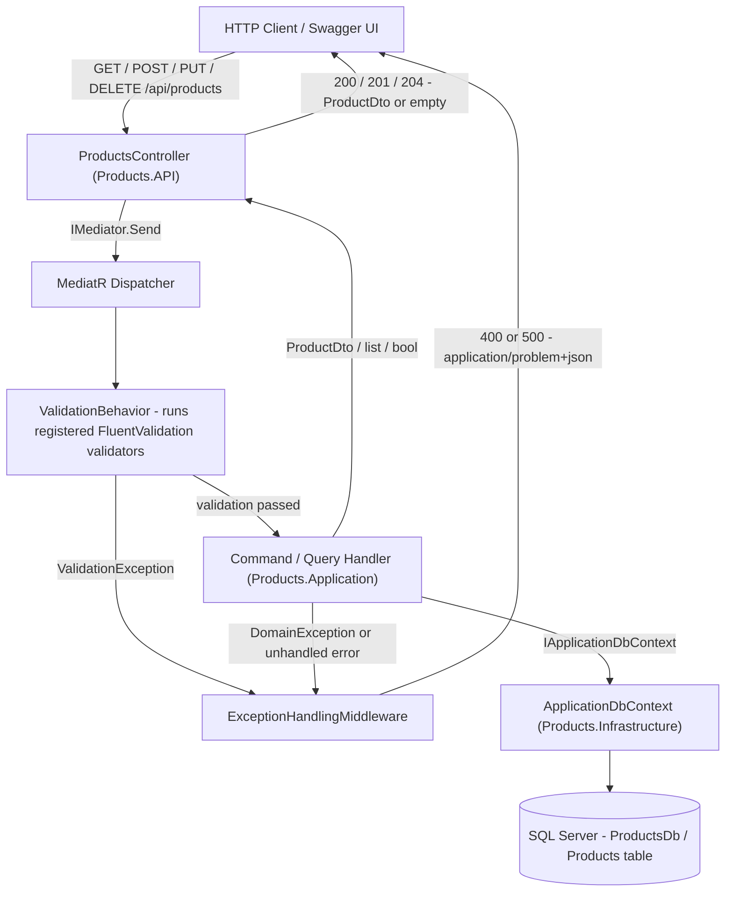
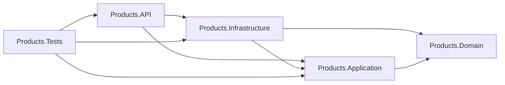

# Products API — Clean Architecture & CQRS

A product-management REST API built with **ASP.NET Core Web API** on **.NET 10**, structured with **Clean Architecture** and **CQRS**. Write and read operations are expressed as commands and queries, dispatched through **MediatR**, validated with **FluentValidation**, and persisted to **SQL Server** through **Entity Framework Core**. Swagger/OpenAPI documentation is generated with Swashbuckle.

---

## Table of Contents

- [Overview](#overview)
- [Features](#features)
- [Technology Stack](#technology-stack)
- [Architecture](#architecture)
- [Project Structure](#project-structure)
- [Prerequisites](#prerequisites)
- [Getting Started](#getting-started)
- [Configuration](#configuration)
- [API Endpoints](#api-endpoints)
- [Request and Response Examples](#request-and-response-examples)
- [Validation](#validation)
- [CQRS Implementation](#cqrs-implementation)
- [Database and Migrations](#database-and-migrations)
- [Running Tests](#running-tests)
- [Error Handling and Troubleshooting](#error-handling-and-troubleshooting)
- [Future Improvements](#future-improvements)
- [License](#license)

---

## Overview

The API exposes CRUD operations over a `Product` resource (`Id`, `Name`, `Price`). Clients can list products, fetch a single product, create, update, and delete products; invalid input is rejected before any handler runs.

**Clean Architecture** splits the solution into four layers. `Products.Domain` holds entities and business invariants and depends on nothing. `Products.Application` holds DTOs, commands, queries, handlers, validators, and the `IApplicationDbContext` abstraction — it depends only on `Products.Domain`. `Products.Infrastructure` implements that abstraction with EF Core and SQL Server. `Products.API` is the composition root: controllers, middleware, Swagger, and DI registration. Business rules never leak into controllers, and the domain never learns about the database.

**CQRS** separates the model into commands (create, update, delete — each returning `ProductDto` or `bool`) and queries (get all, get by id — each returning `ProductDto` data read with `AsNoTracking()`). Commands and queries are separate request types, so read paths and write paths can evolve independently.

**MediatR** dispatches every request: controllers call `IMediator.Send(...)`, MediatR resolves the matching `IRequestHandler`, and a registered pipeline behavior runs first.

**FluentValidation** validators are registered from the Application assembly and executed by the `ValidationBehavior<,>` pipeline behavior. Failures are aggregated and thrown as a `ValidationException` before the handler executes, which the API middleware converts into a `400` problem response.

**EF Core + SQL Server** provide persistence. `ApplicationDbContext` implements `IApplicationDbContext`, entity mapping lives in `ProductConfiguration`, and schema changes are applied with EF Core migrations.

---

## Features

The following are implemented and present in the code:

- Create a product (`POST /api/products`).
- Retrieve all products (`GET /api/products`).
- Retrieve a product by ID (`GET /api/products/{id}`).
- Update an existing product (`PUT /api/products/{id}`); the route ID is authoritative and cannot be overridden by the body.
- Delete a product (`DELETE /api/products/{id}`).
- Request validation through FluentValidation, executed by a MediatR pipeline behavior.
- Domain-invariant enforcement in the `Product` aggregate (`DomainException`).
- SQL Server persistence via EF Core (`Products` table, identity key, `nvarchar(100)` name, `decimal(18,2)` price).
- EF Core migrations (`InitialCreate` already exists).
- Swagger/OpenAPI UI, enabled in the `Development` environment.
- Centralized exception handling that returns RFC 7807 `application/problem+json` responses.
- Unit tests (validators, pipeline behavior) and integration tests (full API over `WebApplicationFactory`).
- A ready-to-use [`.http`](Products.API/Products.API.http) request file.

---

## Technology Stack

All versions below are read directly from the project's `.csproj` files. The solution targets `net10.0` everywhere and was restored/built with .NET SDK **10.0.300**.

| Technology | Purpose | Version |
|---|---|---|
| .NET / ASP.NET Core | Target framework and Web API host | `net10.0` (SDK 10.0.300) |
| Swashbuckle.AspNetCore | Swagger/OpenAPI document + UI | 10.3.0 |
| MediatR | CQRS command/query dispatching | 12.5.0 |
| FluentValidation | Request validation rules | 11.11.0 |
| FluentValidation.DependencyInjectionExtensions | Registers validators from the assembly | 11.11.0 |
| Microsoft.EntityFrameworkCore | ORM, `DbSet`, change tracking | 10.0.8 |
| Microsoft.EntityFrameworkCore.SqlServer | SQL Server database provider | 10.0.8 |
| Microsoft.EntityFrameworkCore.Design | Design-time services for migrations | 10.0.8 |
| Microsoft.Extensions.Configuration.Abstractions | Reading configuration (`IConfiguration`) | 10.0.8 |
| Microsoft.Extensions.DependencyInjection.Abstractions | DI extension points | 10.0.8 |
| System.Security.Cryptography.Pkcs | Referenced by `Products.Infrastructure` | 10.0.13 |
| xUnit | Test framework | 2.9.3 |
| xunit.runner.visualstudio | Test adapter | 3.1.4 |
| Microsoft.NET.Test.Sdk | Test host | 17.14.1 |
| Microsoft.AspNetCore.Mvc.Testing | `WebApplicationFactory` for integration tests | 10.0.8 |
| coverlet.collector | Code coverage collection | 6.0.4 |
| SQL Server | Relational database | Not pinned in the repo; the default connection string targets a local `.\SQLEXPRESS` instance |

`Products.Domain` intentionally has **no** package references.

---

## Architecture

### Project responsibilities

| Project | Responsibility | Depends on |
|---|---|---|
| `Products.Domain` | `Product` entity with private setters, `Product.Create` / `Product.Update` factories that enforce invariants, `MaxNameLength`, and `DomainException`. No framework or infrastructure references. | — |
| `Products.Application` | DTOs, commands, queries, handlers, FluentValidation validators, the `ValidationBehavior` pipeline behavior, the `IApplicationDbContext` abstraction, and `AddApplication()` DI registration. | `Products.Domain` |
| `Products.Infrastructure` | `ApplicationDbContext`, `ProductConfiguration` entity mapping, EF Core migrations, and `AddInfrastructure(IConfiguration)` which registers the SQL Server `DbContext` and maps `IApplicationDbContext` to it. | `Products.Application`, `Products.Domain` |
| `Products.API` | `ProductsController`, `ExceptionHandlingMiddleware`, Swagger configuration, and the `Program.cs` composition root. | `Products.Application`, `Products.Infrastructure` |
| `Products.Tests` | xUnit unit tests for validators/behavior and integration tests that boot the real API against a SQL Server test database. | `Products.API`, `Products.Application`, `Products.Infrastructure` |

### Dependency direction

Dependencies point **inward**: the outermost layer (`Products.API`) composes everything, `Products.Infrastructure` implements the abstraction that `Products.Application` declares, and `Products.Domain` is the innermost layer with zero dependencies. Business logic stays in the Application/Domain layers, and persistence concerns stay in Infrastructure, so the domain can be unit-tested and the database technology can be swapped without touching handlers or controllers.



### Project references



---

## Project Structure

```text
ProductsSolution.sln
README.md
Products.Domain/
├── Products.Domain.csproj
├── Entities/
│   └── Product.cs
└── Exceptions/
    └── DomainException.cs

Products.Application/
├── Products.Application.csproj
├── DependencyInjection.cs              # AddApplication(): MediatR + validators + behavior
├── Behaviors/
│   └── ValidationBehavior.cs           # Pipeline behavior throwing ValidationException
├── DTOs/
│   ├── CreateProductDto.cs
│   ├── UpdateProductDto.cs
│   └── ProductDto.cs                   # Response record (Id, Name, Price)
├── Interfaces/
│   └── IApplicationDbContext.cs        # Persistence abstraction
└── Features/Products/
    ├── Commands/
    │   ├── CreateProduct/              # Command + Handler + Validator
    │   ├── UpdateProduct/              # Command + Handler + Validator
    │   └── DeleteProduct/              # Command + Handler + Validator
    └── Queries/
        ├── GetAllProducts/             # Query + Handler (no validator)
        └── GetProductById/             # Query + Handler + Validator

Products.Infrastructure/
├── Products.Infrastructure.csproj
├── DependencyInjection.cs              # AddInfrastructure(): SQL Server DbContext
└── Persistence/
    ├── ApplicationDbContext.cs
    ├── Configurations/
    │   └── ProductConfiguration.cs
    └── Migrations/
        ├── 20261015130534_InitialCreate.cs
        ├── 20261015130534_InitialCreate.Designer.cs
        └── ApplicationDbContextModelSnapshot.cs

Products.API/
├── Products.API.csproj
├── Program.cs                          # Composition root + Swagger
├── appsettings.json                    # ConnectionStrings:DefaultConnection
├── appsettings.Development.json
├── Products.API.http                   # Sample HTTP requests
├── Properties/launchSettings.json      # http://localhost:5062 / https://localhost:7169
├── Controllers/
│   └── ProductsController.cs
└── Middleware/
    └── ExceptionHandlingMiddleware.cs  # Validation / domain / unhandled -> problem+json

Products.Tests/
├── Products.Tests.csproj
├── Validation/ValidatorTests.cs        # FluentValidation unit tests
├── Behaviors/ValidationBehaviorTests.cs
└── Integration/
    ├── ProductsApiFactory.cs           # WebApplicationFactory + SQL Server test DB
    └── ProductsApiTests.cs             # End-to-end API tests
```

`bin/`, `obj/`, and other build artifacts are omitted.

---

## Prerequisites

- **.NET 10 SDK** — the solution targets `net10.0`. It was restored and built with SDK `10.0.300`; any SDK `10.0.x` that supports `net10.0` should work. Verify with `dotnet --version`.
- **SQL Server** — SQL Server Express, Developer, LocalDB, or a full instance. The checked-in connection string points at `.\SQLEXPRESS`; change it to match your instance.
- **EF Core CLI tool (`dotnet-ef`)** — required only for creating/applying migrations from the command line. It is not vendored in the repository (there is no `.config/dotnet-tools.json`), so install it globally:

  ```bash
  dotnet tool install --global dotnet-ef --version 10.0.8
  ```

- **SQL Server connectivity tooling** (SSMS, `sqlcmd`, Azure Data Studio, …) — optional, useful for verifying the database.
- **Visual Studio 2022 17.x**, **VS Code**, **Rider**, or any editor of your choice.

---

## Getting Started

### 1. Clone the repository

```bash
git clone https://github.com/YOUR_USERNAME/YOUR_REPOSITORY.git
cd YOUR_REPOSITORY
```

### 2. Restore packages

```bash
dotnet restore
```

### 3. Configure the connection string

Edit `Products.API/appsettings.json` (or use environment variables / User Secrets — see [Configuration](#configuration)) so `ConnectionStrings:DefaultConnection` points at your SQL Server instance.

### 4. Verify the EF Core CLI tool

```bash
dotnet ef --version
```

If the command is not found, install it as shown in [Prerequisites](#prerequisites).

### 5. Create the database schema

The `InitialCreate` migration **already exists** in `Products.Infrastructure/Persistence/Migrations`. Do **not** run `dotnet ef migrations add InitialCreate` again — that would produce a duplicate migration. Just apply the existing one:

```bash
dotnet ef database update --project Products.Infrastructure --startup-project Products.API
```

Only use the `migrations add` command after you change the model:

```bash
dotnet ef migrations add <MigrationName> --project Products.Infrastructure --startup-project Products.API
dotnet ef database update --project Products.Infrastructure --startup-project Products.API
```

### 6. Build the solution

```bash
dotnet build
```

### 7. Run the API

```bash
dotnet run --project Products.API
```

The launch profiles in `Products.API/Properties/launchSettings.json` start the app with `ASPNETCORE_ENVIRONMENT=Development` on:

- `http://localhost:5062`
- `https://localhost:7169`

### 8. Open Swagger

In the `Development` environment, browse to:

- Swagger UI: `https://localhost:7169/swagger` (or `http://localhost:5062/swagger`)
- OpenAPI document: `/swagger/v1/swagger.json`

You can also fire the sample requests in [`Products.API/Products.API.http`](Products.API/Products.API.http) from Visual Studio/VS Code.

---

## Configuration

### Connection string

The only configuration key the application requires is `ConnectionStrings:DefaultConnection`, read in `Products.Infrastructure/DependencyInjection.cs`. If it is missing, startup fails with:

```text
Connection string 'DefaultConnection' was not found in configuration.
```

**`Products.API/appsettings.json` (shape shown with placeholders — replace the values for your environment):**

```json
{
  "ConnectionStrings": {
    "DefaultConnection": "Server=YOUR_SERVER;Database=ProductsDb;Trusted_Connection=True;TrustServerCertificate=True;MultipleActiveResultSets=true"
  }
}
```

- `Trusted_Connection=True` means Windows integrated authentication (no username/password in the file). This is the approach the repository ships with.
- For SQL authentication, use `User Id=YOUR_USER;Password=YOUR_PASSWORD;TrustServerCertificate=True` instead — keep such values **out of source control**.

### Environment variables

Environment variables override `appsettings.json`. The `__` separator maps to configuration sections:

```powershell
# PowerShell
$env:ConnectionStrings__DefaultConnection = "Server=YOUR_SERVER;Database=ProductsDb;Trusted_Connection=True;TrustServerCertificate=True"
dotnet run --project Products.API
```

```bash
# bash / cmd
export ConnectionStrings__DefaultConnection="Server=YOUR_SERVER;Database=ProductsDb;Trusted_Connection=True;TrustServerCertificate=True"
```

### .NET User Secrets (Development only)

`Products.API` does **not** currently define a `UserSecretsId`, so initialise it once before storing secrets (this adds a `UserSecretsId` property to `Products.API.csproj`):

```bash
cd Products.API
dotnet user-secrets init
dotnet user-secrets set "ConnectionStrings:DefaultConnection" "Server=YOUR_SERVER;Database=ProductsDb;Trusted_Connection=True;TrustServerCertificate=True"
```

`WebApplication.CreateBuilder` loads user secrets automatically when `ASPNETCORE_ENVIRONMENT=Development`, which is the default for `dotnet run` via `launchSettings.json`. Prefer environment variables if you would rather not touch the project file.

### Test database

Integration tests read the `TEST_CONNECTION_STRING` environment variable and fall back to a `ProductsDb_IntegrationTests` database on `.\SQLEXPRESS`. See [Running Tests](#running-tests).

---

## API Endpoints

Base route: `api/products` (declared by `[Route("api/products")]` on `ProductsController`).

| Method | Route | Description | Success | Error status codes |
|---|---|---|---|---|
| `GET` | `/api/products` | Retrieve all products (ordered by `Id`; empty array when none exist) | `200 OK` | `500` |
| `GET` | `/api/products/{id}` | Retrieve a single product by ID | `200 OK` | `400` (ID ≤ 0 or non-numeric), `404`, `500` |
| `POST` | `/api/products` | Create a product; returns `201` with a `Location` header | `201 Created` | `400`, `500` |
| `PUT` | `/api/products/{id}` | Update an existing product (route ID wins over body) | `200 OK` | `400`, `404`, `500` |
| `DELETE` | `/api/products/{id}` | Delete an existing product; no response body | `204 No Content` | `400`, `404`, `500` |

Notes:

- The controller declares `ProducesResponseType` attributes for `200`/`201`/`204`, `400`, and `404` as listed; `500` comes from `ExceptionHandlingMiddleware` for unhandled exceptions.
- Non-numeric route values such as `/api/products/abc` are rejected by ASP.NET Core model binding (`[ApiController]`) with `400 Bad Request`.
- There is no authentication/authorization configured, so all endpoints are anonymous.

---

## Request and Response Examples

> The samples below are illustrative and use sample data. They match the shapes asserted by the integration tests, but were not captured from a live server during this documentation pass.

### Create a product

```http
POST /api/products
Content-Type: application/json
```

```json
{
  "name": "Laptop",
  "price": 25000.00
}
```

`201 Created` — response body plus a `Location` header pointing at `/api/products/1`:

```json
{
  "id": 1,
  "name": "Laptop",
  "price": 25000.00
}
```

### Retrieve all products

```http
GET /api/products
```

`200 OK`:

```json
[
  { "id": 1, "name": "Laptop", "price": 25000.00 },
  { "id": 2, "name": "Keyboard", "price": 1200.00 }
]
```

An empty collection returns `200 OK` with `[]`.

### Retrieve a product by ID

```http
GET /api/products/1
```

`200 OK`:

```json
{
  "id": 1,
  "name": "Laptop",
  "price": 25000.00
}
```

`404 Not Found` (empty body) when the ID does not exist; `400 Bad Request` when `id` is `0`, negative, or non-numeric.

### Update a product

```http
PUT /api/products/1
Content-Type: application/json
```

```json
{
  "name": "Updated Laptop",
  "price": 27000.00
}
```

`200 OK`:

```json
{
  "id": 1,
  "name": "Updated Laptop",
  "price": 27000.00
}
```

Any `id` supplied in the body is ignored — the route value is authoritative. `404 Not Found` (empty body) when the product does not exist; `400 Bad Request` for invalid data. A `PUT` never creates a missing product.

### Delete a product

```http
DELETE /api/products/1
```

`204 No Content` with **no response body**. An unknown ID returns `404 Not Found` with an empty body, and an invalid ID (zero, negative, or non-numeric) returns `400 Bad Request`.

### Validation failure (`400 Bad Request`)

Returned by `ExceptionHandlingMiddleware` as `application/problem+json` (errors grouped by camel-cased property name):

```json
{
  "title": "One or more validation errors occurred.",
  "status": 400,
  "detail": "The request contains invalid values.",
  "instance": "/api/products",
  "errors": {
    "name": ["'Name' must not be empty."],
    "price": ["'Price' must be greater than '0'."]
  }
}
```

### Domain rule violation (`400 Bad Request`)

```json
{
  "title": "A business rule was violated.",
  "status": 400,
  "detail": "Product price must be greater than zero.",
  "instance": "/api/products"
}
```

### Unexpected error (`500 Internal Server Error`)

```json
{
  "title": "An internal server error occurred.",
  "status": 500,
  "detail": "An unexpected error occurred. Please try again later.",
  "instance": "/api/products/1"
}
```

Outside the `Development` environment the `detail` value is always the generic message above; in `Development` it contains the actual exception message. Stack traces are never returned.

---

## Validation

Validation runs **twice**: FluentValidation validators reject bad input in the MediatR pipeline, and the `Product.Update` method re-checks the same invariants as a domain guard (throwing `DomainException`).

### FluentValidation rules

| Validator | Rules |
|---|---|
| `CreateProductCommandValidator` | `Name` — `NotEmpty()`, `MaximumLength(100)`; `Price` — `GreaterThan(0)` |
| `UpdateProductCommandValidator` | `Id` — `GreaterThan(0)`; `Name` — `NotEmpty()`, `MaximumLength(100)`; `Price` — `GreaterThan(0)` |
| `DeleteProductCommandValidator` | `Id` — `GreaterThan(0)` |
| `GetProductByIdQueryValidator` | `Id` — `GreaterThan(0)` |
| `GetAllProductsQuery` | No validator registered (a list query has no inputs) |

The maximum name length is `Product.MaxNameLength = 100`, defined in the domain and mirrored by the `nvarchar(100)` column.

### How failures reach the client

1. `ValidationBehavior<TRequest, TResponse>` resolves all `IValidator<TRequest>` instances for the incoming request.
2. If any validator fails, it throws `FluentValidation.ValidationException` **before** the handler runs, so no data is written.
3. `ExceptionHandlingMiddleware` catches it, groups messages by camel-cased property name, and returns `400 Bad Request` with `application/problem+json` and an `errors` dictionary.

Request bodies are also covered by ASP.NET Core's automatic model validation for malformed payloads (for example a missing `name` property), which returns the framework's own `ValidationProblemDetails` with `400 Bad Request`.

---

## CQRS Implementation

Every operation is a single `IRequest<T>` dispatched through `IMediator.Send`. Controllers never call the `DbContext` directly.

### Commands (writes)

| Command | Returns | Handler behaviour |
|---|---|---|
| `CreateProductCommand(string Name, decimal Price)` | `ProductDto` | Builds the aggregate with `Product.Create`, adds it, saves changes |
| `UpdateProductCommand(int Id, string Name, decimal Price)` | `ProductDto?` | Loads the product, returns `null` (→ `404`) when absent, otherwise `product.Update(...)` and saves |
| `DeleteProductCommand(int Id)` | `bool` | Returns `false` (→ `404`) when absent, otherwise removes the entity and saves |

### Queries (reads)

| Query | Returns | Handler behaviour |
|---|---|---|
| `GetAllProductsQuery` | `IReadOnlyList<ProductDto>` | `AsNoTracking()`, ordered by `Id`, projected to `ProductDto` |
| `GetProductByIdQuery(int Id)` | `ProductDto?` | `AsNoTracking()` lookup; `null` → `404` |

### Dispatch and pipeline

`Products.Application/DependencyInjection.cs` registers:

- `MediatR` handlers from the Application assembly.
- `ValidationBehavior<,>` as an **open pipeline behavior** (runs before every handler).
- All FluentValidation validators from the Application assembly.

The controller's `IMediator` is injected via primary-constructor injection on `ProductsController`.

---

## Database and Migrations

### `ApplicationDbContext`

`Products.Infrastructure/Persistence/ApplicationDbContext.cs` implements `IApplicationDbContext`:

- `DbSet<Product> Products`
- `OnModelCreating` applies every `IEntityTypeConfiguration<>` in the Infrastructure assembly.

### Entity mapping

`ProductConfiguration` maps the `Product` aggregate to the `Products` table:

| Column | Type | Constraints |
|---|---|---|
| `Id` | `int` | Primary key, database-generated identity (`1, 1`) |
| `Name` | `nvarchar(100)` | Required, max length 100 |
| `Price` | `decimal(18,2)` | Required, precision 18 / scale 2 |

### Connection

`AddInfrastructure(IConfiguration)` reads `ConnectionStrings:DefaultConnection` and calls `options.UseSqlServer(connectionString)`. `IApplicationDbContext` is registered as a scoped alias for `ApplicationDbContext`.

### Applying migrations

An `InitialCreate` migration already exists, so apply it rather than recreating it:

```bash
dotnet ef database update --project Products.Infrastructure --startup-project Products.API
```

After changing the model:

```bash
dotnet ef migrations add <MigrationName> --project Products.Infrastructure --startup-project Products.API
dotnet ef database update --project Products.Infrastructure --startup-project Products.API
```

`--startup-project Products.API` is required so the design-time host can load configuration; `--project Products.Infrastructure` is required so the migration files are written into the Infrastructure project.

To inspect the generated SQL:

```bash
dotnet ef migrations script --project Products.Infrastructure --startup-project Products.API
```

---

## Running Tests

```bash
dotnet test
```

Or target only the test project:

```bash
dotnet test Products.Tests
```

### Test layout

| Project / folder | Type | Purpose |
|---|---|---|
| `Products.Tests/Validation/ValidatorTests.cs` | Unit | FluentValidation rules for create, update, delete, and get-by-id |
| `Products.Tests/Behaviors/ValidationBehaviorTests.cs` | Unit | Pipeline behavior: throws before the handler, aggregates failures, skips when no validators |
| `Products.Tests/Integration/ProductsApiTests.cs` | Integration | End-to-end HTTP behaviour: status codes, `Location` header, persistence, validation errors, Swagger document |
| `Products.Tests/Integration/ProductsApiFactory.cs` | Integration host | `WebApplicationFactory<Program>` that migrates and resets a dedicated SQL Server test database |

### Requirements for integration tests

- A reachable SQL Server. The default is `.\SQLEXPRESS` with the database `ProductsDb_IntegrationTests` (created and migrated automatically on startup).
- Override the target with an environment variable:

  ```powershell
  $env:TEST_CONNECTION_STRING = "Server=YOUR_SERVER;Database=ProductsDb_IntegrationTests;Trusted_Connection=True;TrustServerCertificate=True;MultipleActiveResultSets=true"
  dotnet test
  ```

- Each test class run resets the `Products` table (`DELETE` + identity reseed), so tests are order-independent but **share one database** — do not point `TEST_CONNECTION_STRING` at a database whose data you care about.

### Verified results

Executed on 15 October 2026 against the local environment:

- `dotnet build ProductsSolution.sln` → **Build succeeded, 0 warnings, 0 errors**
- `dotnet test` → **62 passed, 0 failed, 0 skipped**
  - 27 unit tests (`Validation` + `Behaviors`)
  - 35 integration tests (`Integration`, requires SQL Server)

---

## Error Handling and Troubleshooting

### Error pipeline

`ExceptionHandlingMiddleware` runs before the MVC pipeline and converts exceptions into `application/problem+json`:

| Exception | Status | Body |
|---|---|---|
| `FluentValidation.ValidationException` | `400` | `ValidationProblemDetails` with an `errors` dictionary |
| `Products.Domain.Exceptions.DomainException` | `400` | `ProblemDetails` — "A business rule was violated." |
| Any other exception | `500` | `ProblemDetails`; `detail` contains the exception message only in `Development` |

### Common problems

| Symptom | Cause | Fix |
|---|---|---|
| Startup fails with `Connection string 'DefaultConnection' was not found in configuration.` | The key is missing from configuration | Add `ConnectionStrings:DefaultConnection` to `appsettings.json`, an environment variable, or User Secrets |
| `A network-related or instance-specific error occurred...` / login failed | SQL Server unreachable or wrong instance name | Verify the server name (`.\SQLEXPRESS` vs `(localdb)\MSSQLLocalDB` vs `localhost`), that the SQL Server service is running, and that your credentials are correct |
| `Cannot open database "ProductsDb"` | Migrations have not been applied | Run `dotnet ef database update --project Products.Infrastructure --startup-project Products.API` |
| `dotnet ef` reports "The term 'dotnet-ef' is not recognized" | EF Core CLI tool not installed | `dotnet tool install --global dotnet-ef --version 10.0.8`, then restart the terminal |
| Duplicate/conflicting migrations | `migrations add` was run for a model that already has `InitialCreate` | Do not re-create `InitialCreate`; add a new migration only for actual model changes |
| `404` on `/swagger` | Swagger is registered only for the `Development` environment | Run with `ASPNETCORE_ENVIRONMENT=Development` (the default `dotnet run` launch profile already does this) |
| `307` redirect or connection refused on a port | Port conflict or HTTPS redirection | Stop the process already using the port, or change `applicationUrl` in `Products.API/Properties/launchSettings.json` (`5062` / `7169` by default) |
| Integration tests fail before any assertion | No SQL Server test database reachable | Start SQL Server and set `TEST_CONNECTION_STRING`, or let it fall back to `.\SQLEXPRESS` with `ProductsDb_IntegrationTests` |
| Restore/build fails with package or framework errors | SDK does not match `net10.0` | Install a .NET 10 SDK (`dotnet --list-sdks` should show a 10.0.x SDK) |
| `HTTPS` certificate warnings in the browser | Local dev certificate not trusted | Run `dotnet dev-certs https --trust` |

---

## Future Improvements

The following are **proposals only** and are not implemented in this repository:

- Pagination, sorting, and filtering for `GET /api/products`.
- Authentication and authorization (JWT/bearer identity), plus role-based authorization on mutating endpoints.
- Structured logging with a logging library (Serilog) and correlation IDs.
- Domain events and a mediator-based outbox for side effects.
- Soft delete, auditing fields (`CreatedAt`/`UpdatedAt`), and optimistic concurrency.
- Additional integration test isolation (per-test database or containers).
- Docker support (`Dockerfile`, `docker-compose` with SQL Server).
- CI/CD pipeline and code coverage reporting.
- API versioning and rate limiting.

---

## License

No license file is present in this repository, so no license has been specified.
